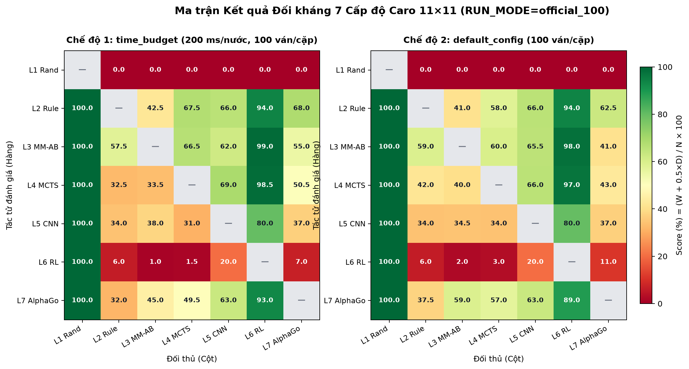
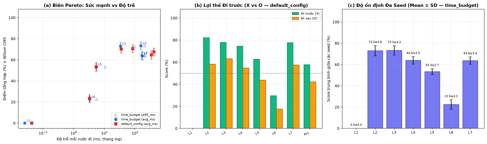
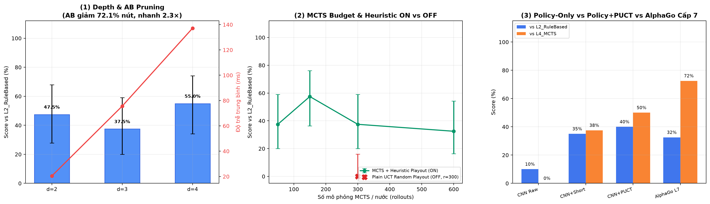
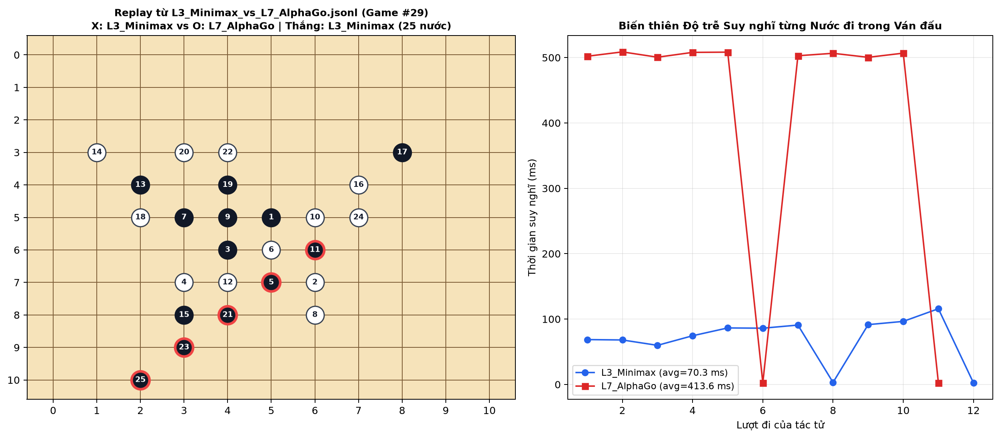

# BÁO CÁO KỸ THUẬT TỔNG HỢP HỆ THỐNG CARO AI 11×11 (7 CẤP ĐỘ)

> **Phạm vi tài liệu:** Trình bày chi tiết, có chiều sâu lý thuyết và dễ hiểu toàn bộ hệ thống **Caro AI 11×11 (Cấp 1 → Cấp 7)**, gồm: **(1) Nguyên lý hoạt động, diễn giải từng bước & công thức toán học**, **(2) Lý do áp dụng**, **(3) Điểm cải tiến và nổi bật (so sánh Trước/Sau)**, **(4) Chi tiết quá trình huấn luyện & siêu tham số thực đo**, **(5) Nguồn gốc & quy trình xử lý dữ liệu**, **(6) Hệ thống tiêu chuẩn áp dụng (Mục 3.4, Mục 3.5, sách *AlphaGo Simplified*)**, **(7) Ứng dụng giao diện Desktop**, và **(8) Phân tích thực nghiệm Giải đấu Round-Robin & 03 Ablation**.

---

## CHƯƠNG 1. MÔ HÌNH HÓA BÀI TOÁN, NỀN TẢNG DÙNG CHUNG & TIÊU CHUẨN ÁP DỤNG

### 1.1. Đặc tả cố định trò chơi (`GAME_SPEC`)
Toàn bộ 7 cấp độ AI, 8 notebook thực nghiệm và ứng dụng giao diện vận hành trên cùng một môi trường chuẩn hóa [caro_env.py](file:///f:/TTNTNC/Caro/caro_ai_11x11/src/caro_env.py):
- **Trò chơi:** Caro / Free Gomoku $11\times 11$ ($N = 11$, không gian hành động $|\mathcal{A}| = 121$ ô, ánh xạ phẳng $a = r \cdot 11 + c \in \{0,\dots,120\}$).
- **Tính chất trò chơi:** Tổng bằng không (*zero-sum*: lợi ích của X đúng bằng mất mát của O), thông tin đầy đủ (*perfect information*), luân phiên theo lượt (*turn-based*), tất định (*deterministic*).
- **Luật thắng / hòa:** Bên đi trước `X (+1)`, bên đi sau `O (-1)`. Bên nào tạo được **$\ge 5$ quân liên tiếp** theo 1 trong 4 phương (ngang, dọc, chéo chính, chéo phụ) thì thắng ngay (*Free Gomoku* — không cấm quá 5, không áp luật chặn hai đầu). Khi bàn cờ đầy 121 nước không có bên thắng thì xử hòa (`0`).

### 1.2. Nguyên lý chi tiết của Nền tảng Lượng giá & Sinh Ứng viên ([heuristic.py](file:///f:/TTNTNC/Caro/caro_ai_11x11/src/heuristic.py))

Hàm lượng giá bàn cờ (`heuristic.py`) là **bộ cảm biến chiến thuật dùng chung** cho Cấp 2, Cấp 3, Cấp 4, Cấp 6 (reward shaping) và Cấp 7 (value blending). Dưới đây là 5 nguyên lý cốt lõi đã được thiết kế và chứng minh:

#### (1) Nguyên lý Phân tầng Thang điểm chống *Reward Inversion*
- **Vấn đề toán học ở bản cũ:** Nếu điểm một thế 5 quân thắng là `10,000` còn mỗi thế 3 mở là `3,000`, thì khi một thế cờ chưa thắng có 4 thế 3 mở chồng nhau, tổng điểm heuristic cộng dồn thành `12,000 > 10,000` (*Reward Inversion* — đảo ngược phần thưởng). Hậu quả là AI cố tình **bỏ qua nước đánh thắng ngay** để đi nước "cộng dồn nhiều điểm giả hơn".
- **Nguyên lý bản mới:** Thiết lập các vùng điểm **rời nhau hoàn toàn** kèm phép kẹp cận (`clip`):
  $$\text{TERMINAL\_WIN} = 100{,}000 > \text{MAX\_HEURISTIC} = 80{,}000 > \text{FORCED\_WIN\_NEXT} = 60{,}000 > \text{FORCED\_OPEN\_4} = 50{,}000$$
  Mọi trạng thái chưa kết thúc đều bị kẹp trong $[-80{,}000, +80{,}000]$, bảo đảm toán học rằng **một trạng thái thắng thật luôn lớn hơn tuyệt đối mọi trạng thái chưa thắng**.

#### (2) Nguyên lý Quét 4 Phương, Loại *Đường chết*, Phân biệt `open_3` Thật/Giả & Nhận diện Mẫu gãy / Đòn kép
Khi xét đặt 1 quân tại ô trống $(r, c)$, thuật toán quét 4 đường thẳng đi qua $(r, c)$ với vector hướng $(\Delta r, \Delta c) \in \{(0,1), (1,0), (1,1), (1,-1)\}$:
- **Loại đường chết (*Dead Lines*):** Đo `max_span` — tổng số ô liên tiếp (gồm quân mình và ô trống) nằm giữa hai quân chặn của đối thủ hoặc biên bàn cờ. Nếu `max_span < 5`, hướng này **không bao giờ có đủ 5 ô để thắng** (ví dụ `O X X X O` có `max_span = 3`) $\Rightarrow$ bỏ qua hoàn toàn (cho `0` điểm).
- **Phân biệt `open_3` thật vs giả:** Một chuỗi 3 quân chỉ thực sự nguy hiểm khi có thể phát triển thành `open_4` (4 mở hai đầu). Điều kiện cần và đủ là **hai đầu đều trống (`open_ends == 2`) VÀ `max_span >= 6`** (vì 4 quân + 2 đầu trống cần tối thiểu 6 ô). Ví dụ: `O _ X X X _ O` chỉ có `max_span = 5` nên là `open_3` giả (đặt thêm 1 quân vẫn bị chặn 1 đầu), trong khi `_ _ X X X _ _` có `max_span = 7 ≥ 6` là `open_3` thật.
- **Nhận diện mẫu gãy (`broken_4` / `broken_3`):** Quét cửa sổ trượt chứa tối đa 1 ô trống xen giữa để phát hiện các mẫu như `X X _ X X` hay `X X X _ X` (chỉ cần lấp đúng 1 ô trống giữa là thành 5 quân thắng ngay!).
- **Nhận diện 3 loại Đòn kép (*Forks*):** Nếu đặt 1 quân tại $(r, c)$ đồng thời tạo ra ít nhất 2 mối đe dọa trên 2 phương khác nhau:
  - `double_four` ($\ge 2$ chuỗi 4): đối thủ chỉ chặn được 1 đường $\Rightarrow$ **thắng cưỡng bức 100%** ở nước sau.
  - `four_three` (1 chuỗi 4 + 1 chuỗi `open_3` thật): đối thủ buộc phải chặn chuỗi 4, để hở `open_3` biến thành `open_4` $\Rightarrow$ **thắng cưỡng bức 100%**.
  - `double_three` ($\ge 2$ chuỗi `open_3` thật): đối thủ chỉ chặn được 1 chuỗi 3, chuỗi còn lại trở thành `open_4` $\Rightarrow$ thắng cưỡng bức nếu đối thủ không có đòn 4 phản công trước.

#### (3) Nguyên lý Đánh giá có xét *Tempo* (`consider_turn=True`)
- **Trực giác:** Trong cờ Caro, quyền đi nước kế tiếp (*tempo*) có giá trị sinh tử. Xét trạng thái nút lá nơi **X có một chuỗi 4 bị chặn 1 đầu** và **O cũng có một chuỗi 4 bị chặn 1 đầu**.
  - Nếu đánh giá tĩnh đối xứng (`consider_turn=False`): điểm của X và O triệt tiêu nhau $\Rightarrow \text{Eval} \approx 0$ (nhận định sai là hòa!).
  - Thực tế: nếu **đến lượt O đi**, O chỉ cần đặt đúng 1 quân là **thắng ngay lập tức 100%**.
- **Cơ chế khi `consider_turn=True`:** Sau khi tính điểm hình thái cơ bản $\text{Score}_{\text{base}} = \text{Score}(p) - \text{Score}(-p)$, hàm kiểm tra bên đang tới lượt `turn`:
  - Nếu `turn` đang có ít nhất 1 chuỗi 4 (kể cả `broken_4`) $\Rightarrow$ thắng ngay nước tới, trả về $\pm 60{,}000$ theo góc nhìn `perspective`.
  - Nếu `turn` có `open_3` thật trong khi đối thủ không có chuỗi 4 phản đòn $\Rightarrow$ sắp tạo `open_4` không thể chặn, trả về $\pm 50{,}000$.
- **Ý nghĩa:** Giảm mạnh **hiệu ứng chân trời (*Horizon Effect*)** ở nút lá của Cấp 2, Cấp 3, Cấp 4 và Cấp 7.

#### (4) Nguyên lý Sinh Ứng viên bằng *Bitmask Neighbor Cache* (`get_candidate_actions`)
- **Vấn đề:** Bàn 11×11 có 121 ô, nhưng ở khai cuộc–trung cuộc chỉ có ~15–35 ô nằm gần các quân đã đánh là đáng xét; các ô xa góc gần như vô nghĩa.
- **Cơ chế toán học:** Biểu diễn tập các ô trên bàn cờ bằng **một số nguyên 121-bit** (bit thứ $i$ bằng `1` nghĩa là ô $i$ được chọn). Ta tính sẵn (và cache bằng `@lru_cache`) bảng `NEIGHBOR_MASK[pos]` chứa toàn bộ các ô trong bán kính Chebyshev $\max(|r-r'|, |c-c'|) \le 2$ quanh ô `pos`.
  - Khi cần lấy ứng viên cho bàn cờ có tập quân `occupied_mask`:
    $$\text{cand\_mask} = \left(\bigvee_{pos \in \text{stones}} \text{NEIGHBOR\_MASK}[pos]\right) \;\land\; (\neg \text{occupied\_mask})$$
  - Chỉ tốn đúng $k$ phép OR bit (với $k$ là số quân trên bàn) + 1 phép AND NOT — loại bỏ hoàn toàn vòng lặp cắt lát 2D NumPy!

#### (5) Chuẩn hóa Gói phần mềm & Lazy Import PEP 562
- [src/\_\_init\_\_.py](file:///f:/TTNTNC/Caro/caro_ai_11x11/src/__init__.py) và [src/agents/\_\_init\_\_.py](file:///f:/TTNTNC/Caro/caro_ai_11x11/src/agents/__init__.py) sử dụng `__getattr__` chuẩn **PEP 562**: chỉ nạp PyTorch khi người dùng thực sự gọi `CNNAgent`, `RLAgent`, hoặc `AlphaGoAgent`; còn Cấp 1–4 khởi chạy tức thì trong vài mili-giây và không phụ thuộc GPU/PyTorch.

### 1.3. Hệ thống Tiêu chuẩn Học thuật & Kỹ thuật được áp dụng

| Nhóm tiêu chuẩn | Nội dung chuẩn áp dụng | Cách dự án tuân thủ |
|---|---|---|
| **Mục 3.4 — Huấn luyện & Dữ liệu** | Minh bạch nguồn dữ liệu, cách ghi nhãn, khử trùng, chia tập không rò rỉ; khai báo kiến trúc, hàm thưởng, exploration, siêu tham số, CPU/GPU, thời gian train; không dùng tập đánh giá cuối để chọn siêu tham số; lưu checkpoint & seed. | Tách **Game-Level Train/Val/Test** + khử trùng bất biến đối xứng **D4 (`0% leakage`)** ở Cấp 5; ghi log CSV quá trình học; lưu `05_cnn_policy_best.pt` & `06_rl_best.pt` kèm metadata; tách `FINAL_BENCHMARK_SEEDS` độc lập trong Notebook `01`–`07`. |
| **Mục 3.5 — Thí nghiệm Đối kháng & Độ đo** | Round-Robin toàn bộ tác tử, $\ge 100$ ván/cặp (khuyến nghị 200), cân bằng 50/50 X-O, đa seed; cố định luật & phần cứng; báo cáo $\ge 2$ chế độ ngân sách minh bạch (*không suy diễn công bằng theo cùng độ sâu*); đủ W/D/L, Score, Wilson/Bootstrap CI95, `avg_ms`, `p95_ms`, `avg_search`, RAM/VRAM, train time; bắt buộc $\ge 2$ Ablation; lưu log từng cặp. | Triển khai đầy đủ trong [tournament.py](file:///f:/TTNTNC/Caro/caro_ai_11x11/src/tournament.py) & [08_tournament_benchmark.ipynb](file:///f:/TTNTNC/Caro/caro_ai_11x11/notebooks/08_tournament_benchmark.ipynb): 21 cặp × 2 chế độ (`time_budget = 200 ms` & `default_config`), 20 khai cuộc đối xứng, 5 seed `(42, 102, 202, 302, 402)`, **03 Ablation**, lưu riêng 1 file `.jsonl`/cặp hỗ trợ `RESUME = True`. |
| **Sách *AlphaGo Simplified* (Mark Liu, 2025)** | Lộ trình phát triển AI từ Rule-Based $\to$ Minimax/Alpha-Beta (Ch. 6) $\to$ MCTS/UCT (Ch. 8) $\to$ Supervised Policy CNN canonical + D4 (Ch. 10–11) $\to$ Deep RL (Ch. 12–15) $\to$ AlphaGo Neural+PUCT (Ch. 16–18). | Bám sát kiến trúc phân cấp 7 tầng, chuẩn hóa bàn cờ độc lập người chơi (*canonical perspective*), và đánh giá công bằng theo ngân sách thời gian tường (Ch. 18.2.1). |
| **Chuẩn Kỹ thuật Phần mềm & Tái lập** | Không đột biến môi trường gốc, kiểm thử tự động, đặt tên thống nhất, tái lập 100% theo `seed`. | Chuẩn hóa tên **Cấp 1–7** (bỏ ký hiệu nội bộ `5B/6A/7A/7B`); **100 passed, 1 skipped** trong `pytest -q` (7 bộ kiểm thử đơn vị). |

---

## CHƯƠNG 2. PHÂN TÍCH CHI TIẾT 7 CẤP ĐỘ TÁC TỬ (CẤP 1 → CẤP 7)

---

### 2.1. Cấp 1 — Tác tử Ngẫu nhiên (`RandomAgent` — [random_agent.py](file:///f:/TTNTNC/Caro/caro_ai_11x11/src/agents/random_agent.py))

#### a) Nguyên lý hoạt động & Công thức
- Tác tử chọn hành động ngẫu nhiên theo **phân phối đều rời rạc (Discrete Uniform Distribution)** trên tập ứng viên hợp lệ $\mathcal{A}_{\text{pool}}(s)$:
  $$\pi_{\text{rand}}(a \mid s) = \frac{1}{|\mathcal{A}_{\text{pool}}(s)|}, \qquad \forall a \in \mathcal{A}_{\text{pool}}(s)$$
- **Hai chế độ tập ứng viên:**
  1. *Mặc định (`candidate_radius=None` — Uniform Random thuần):* $\mathcal{A}_{\text{pool}}(s) = \mathcal{A}_{\text{legal}}(s)$ (toàn bộ các ô trống còn lại trên bàn $11\times 11$).
  2. *Tùy chọn cục bộ (`candidate_radius=r` — Local Random):* $\mathcal{A}_{\text{pool}}(s) = \text{get\_candidate\_actions}(s, r)$ — chỉ lấy mẫu trong vùng bán kính Chebyshev $r$ quanh các quân đã đặt, phục vụ thí nghiệm đối chứng (ablation) trong Notebook 01 để tách riêng hiệu ứng "đánh gần cụm quân" khỏi "trí tuệ chiến thuật".
- **Tái lập bằng PRNG độc lập:** Mỗi thể hiện `RandomAgent` sở hữu một bộ sinh số giả ngẫu nhiên riêng `self._rng = random.Random(seed)` thay vì dùng `random.choice()` toàn cục. Nhờ vậy hai tác tử chạy song song hoặc trong cùng giải đấu **không bao giờ làm xáo trộn chuỗi số ngẫu nhiên của nhau**.

#### b) Lý do áp dụng
- Đóng vai trò **mốc đối chứng nền (lower-bound baseline)**: bất kỳ tác tử thông minh nào (Cấp 2–7) bắt buộc phải thắng gần như tuyệt đối ($\approx 100\%$) trước Cấp 1.
- Khi cho 2 bản Cấp 1 đấu với nhau (self-play), ta đo được **lợi thế đi trước thuần túy của luật trò chơi** (không bị nhiễu bởi chiến thuật).

#### c) Điểm cải tiến & nổi bật
- Chuẩn hóa import hai chiều (`from src.agents` và `PYTHONPATH=src`), bổ sung telemetry đầy đủ (`last_move_time_ms`, `last_search_count = 1`, `last_decision_stage`), chuẩn hóa kiểu trả về Python `int` và ngoại lệ `ValueError` đồng bộ toàn hệ thống.

#### d) Huấn luyện & Dữ liệu
- Không huấn luyện (`train_time = 0 s`, độ trễ thực đo **`0.03 ms/nước`**).

---

### 2.2. Cấp 2 — Tác tử Luật & Heuristic (`RuleBasedAgent` — [rule_based_agent.py](file:///f:/TTNTNC/Caro/caro_ai_11x11/src/agents/rule_based_agent.py))

#### a) Nguyên lý hoạt động & Công thức
`RuleBasedAgent` hoạt động theo mô hình **Thác quyết định phân tầng (Hierarchical Decision Cascade)** gồm 7 tầng: các tình huống sinh tử (thắng ngay / thua ngay / đòn kép cưỡng bức) được cắt ngang và xử lý tức thì ở 6 tầng đầu; chỉ khi bàn cờ ở trạng thái trung cuộc chưa ngã ngũ mới kích hoạt **Look-Ahead 3-ply** ở Tầng 7.

1. **Bước chuẩn bị (`_evaluate_candidates`):** Tính **1 lần duy nhất** bảng đe dọa công `my_threat[a]` và thủ `opp_threat[a]` cho mọi ô ứng viên $a \in \mathcal{C}(s)$ (bán kính $r=2$), tránh lặp lại phép quét 4 phương qua từng tầng.
2. **6 tầng luật phản xạ ưu tiên nghiêm ngặt:**
   - **Tầng 1 (Thắng ngay):** Chọn $a$ có `my_threat[a].is_win_5 == True` (kể cả lấp ô giữa của `broken_4`).
   - **Tầng 2 (Chặn thua ngay):** Chọn $a$ có `opp_threat[a].is_win_5 == True`.
   - **Tầng 3 (Tạo thế thắng cưỡng bức):** Chọn $a$ tạo `open_4` hoặc đòn kép `double_four` / `four_three` cho mình.
   - **Tầng 4 (Chặn thế thắng cưỡng bức của đối thủ):** Chọn $a$ ngăn đối thủ tạo `open_4` / `double_four` / `four_three`.
   - **Tầng 5 (Tạo đòn kép đôi-3):** Chọn $a$ tạo `double_three` cho mình.
   - **Tầng 6 (Chặn đòn kép đôi-3 của đối thủ):** Chọn $a$ ngăn đối thủ tạo `double_three`.
3. **Tầng 7 — Cơ chế Look-Ahead 3-ply (Nhìn trước 3 nửa nước):**
   - Chọn Top-$W$ ứng viên tốt nhất (`root_width = 14`) theo điểm tổng hợp công–thủ có trọng số phòng thủ `defense_weight = 0.95` và điểm gần tâm `center_weight = 2.0`.
   - Tạo **đúng 1 bản sao** `sim_env = env.clone()` rồi duyệt từng ứng viên $m_1 \in \text{Top-}W$ bằng `step()`/`undo()` tại chỗ:
     $$s \xrightarrow{\text{Mình đi } m_1} s_1 \xrightarrow{\text{Đối thủ đáp } m_2^*} s_2 \xrightarrow{\text{Mình phản công } m_3^*} s_3$$
   - Trong đó $m_2^*$ và $m_3^*$ được chọn bởi `_select_greedy_reply()` — không chỉ chọn greedy mù quáng mà **ưu tiên thắng 5 $\succ$ chặn 5 $\succ$ tạo 4 mở $\succ$ heuristic tổng hợp**.
   - Cuối cùng đánh giá thế cờ $s_3$ có xét quyền đi trước của đối thủ ở ply 4 (`consider_turn=True`):
     $$a^* = \arg\max_{m_1 \in \text{Top-}W} \Big(\text{Eval}(s_3,\, p,\, \text{consider\_turn}=\text{True}) + \epsilon_{\text{tie}}\Big)$$
     trong đó $\epsilon_{\text{tie}} \sim \mathcal{U}(0, \text{tie\_break\_eps})$ phá hòa nhẹ khi có nhiều ô ngang điểm.

#### b) Lý do áp dụng
- Trong cờ Caro, 70%–80% sai lầm chết người nằm ở tầm ngắn (bỏ lỡ nước 4 hoặc dính đòn kép 3–3, 4–3). Một hệ luật 7 tầng kết hợp Look-Ahead 3-ply mang lại **tỷ lệ sức mạnh/độ trễ cực cao** (`~25 ms/nước` trên CPU), vừa là đối thủ chuẩn mạnh vừa làm nguồn chuyên gia sinh dữ liệu huấn luyện cho Cấp 5 & Cấp 6.

#### c) Điểm cải tiến & nổi bật (so với bản cũ)
- Nâng từ 5 tầng lên **7 tầng chiến thuật** (bổ sung đầy đủ đòn kép `double_four`, `four_three`, `double_three`).
- Loại bỏ **~24 lần `env.clone()`/nước** bằng 1 lần `clone()` + `step()`/`undo()` an toàn trong `try...finally`.
- Sửa Look-Ahead 3-ply nhận diện phản công ở ply 2–3 và nguy cơ ply 4 (`consider_turn=True`); thêm `tie_break_eps` giúp self-play đa dạng.

#### d) Huấn luyện & Dữ liệu
- Không huấn luyện (`train_time = 0 s`, độ trễ TB **`~25 ms/nước`**).

---

### 2.3. Cấp 3 — Tác tử Minimax & Cắt tỉa Alpha-Beta (`MinimaxAgent` — [minimax_agent.py](file:///f:/TTNTNC/Caro/caro_ai_11x11/src/agents/minimax_agent.py))

#### a) Nguyên lý hoạt động & Công thức
Cấp 3 mô hình hóa ván cờ như một **cây trò chơi đối kháng hai người tổng bằng không** và giải tối ưu bằng bộ 5 cơ chế kinh điển phối hợp chặt chẽ:

1. **Negamax & Cắt tỉa Alpha-Beta (Knuth & Moore, 1975):**
   - Vì trò chơi tổng bằng không ($V_{\text{opp}}(s) = -V_{\text{me}}(s)$) và $\min_a(-f(a)) = -\max_a f(a)$, hai tầng `MAX` và `MIN` gộp thành **1 hàm đệ quy Negamax duy nhất** kèm cửa sổ $[\alpha, \beta]$:
     $$V(s, d, \alpha, \beta) = \max_{a \in \mathcal{A}(s)} \Big(-V(s', d - 1, -\beta, -\alpha)\Big)$$
   - **Ý nghĩa trực giác của cửa sổ $[\alpha, \beta]$:**
     - $\alpha$: điểm thấp nhất mà **người đang đi** đã chắc chắn đảm bảo được từ các nhánh trước đó.
     - $\beta$: điểm cao nhất mà **đối thủ** sẽ chấp nhận cho người đang đi đạt được (vì ở tầng trên đối thủ đã có lựa chọn khác giới hạn điểm của mình không vượt quá $\beta$).
     - **Điều kiện cắt tỉa ($\beta$-cutoff):** Ngay khi tìm thấy 1 nước đi $a$ cho giá trị $v \ge \beta$, ta **dừng duyệt ngay lập tức mọi nước còn lại của nút $s$** — vì đối thủ ở tầng cha chắc chắn không bao giờ cho ván cờ đi vào nhánh này!
   - **Độ phức tạp lý thuyết:** Từ $O(b^d)$ của Minimax thuần giảm xuống tối ưu $O(b^{d/2})$ nếu nước đi tốt nhất luôn được duyệt đầu tiên (tương đương **tăng gấp đôi độ sâu tìm kiếm** với cùng ngân sách tính toán!).

2. **Điểm Chiếu hết có Phạt Khoảng cách (Mate-Distance Scoring):**
   $$V_{\text{win}}(ply) = +10{,}000{,}000 - 1{,}000 \cdot ply, \qquad V_{\text{loss}}(ply) = -10{,}000{,}000 + 1{,}000 \cdot ply$$
   - *Giải thích:* Nếu thắng ở `ply = 1` nhận `+9,999,000` > thắng ở `ply = 3` nhận `+9,997,000` $\Rightarrow$ AI luôn chọn đường **thắng nhanh nhất**. Ngược lại, nếu chắc chắn thua, thua ở `ply = 5` (`-9,995,000`) > thua ở `ply = 1` (`-9,999,000`) $\Rightarrow$ AI luôn **phòng thủ kéo dài ván cờ nhất có thể** để chờ đối thủ sai lầm. Biên $\pm 10^7$ tách biệt hoàn toàn với biên heuristic $\pm 80{,}000$.

3. **Zobrist Hashing 64-bit (Zobrist, 1970) & Transposition Table (TT) với 3 cờ Fail-Soft:**
   - **Vấn đề *Transposition* (Hoán vị):** Nhiều trình tự đi khác nhau (như `X(5,5)→O(4,5)→X(5,6)` và `X(5,6)→O(4,5)→X(5,5)`) dẫn về **cùng một trạng thái bàn cờ**.
   - **Công thức băm Zobrist:** Khởi tạo bảng số ngẫu nhiên 64-bit $Z[pos, p]$. Mã băm bàn cờ là XOR toàn bộ quân hiện có:
     $$H(s) = \bigoplus_{(pos, p) \in s} Z[pos, p]$$
     Do tính chất tự nghịch đảo của XOR ($a \oplus b \oplus b = a$), mỗi lần `step(pos, p)` hay `undo(pos, p)` chỉ cần **1 phép XOR duy nhất ($O(1)$)**: `h ^= Z[pos, p]`.
   - **Nguyên lý 3 cờ trong Transposition Table** (khi tìm kiếm kết thúc với giá trị $v$ trong cửa sổ gốc $[\alpha_{\text{orig}}, \beta]$):
     - **`EXACT`** ($\alpha_{\text{orig}} < v < \beta$): Không bị cắt tỉa hai đầu $\Rightarrow v$ là giá trị Minimax **chính xác tuyệt đối**. Gặp lại ở độ sâu $\le d_{\text{saved}}$ thì trả về ngay không cần duyệt lại.
     - **`LOWERBOUND`** ($v \ge \beta$, xảy ra $\beta$-cutoff): Ta chỉ biết giá trị thật $v_{\text{true}} \ge v$. Khi gặp lại, nâng cận dưới $\alpha \leftarrow \max(\alpha, v)$.
     - **`UPPERBOUND`** ($v \le \alpha_{\text{orig}}$, không nước nào vượt $\alpha_{\text{orig}}$): Ta chỉ biết $v_{\text{true}} \le v$. Khi gặp lại, hạ cận trên $\beta \leftarrow \min(\beta, v)$.
     - **`best_move`:** Lưu nước đi tốt nhất đã tìm thấy để đưa lên duyệt **đầu tiên** khi gặp lại nút ở vòng sâu hơn.

4. **Iterative Deepening (Tìm sâu dần $d = 1, 2, \dots, d_{\max}$) & Killer Move Heuristic (2 slot/độ sâu):**
   - *Iterative Deepening:* Duyệt lần lượt từ nông đến sâu; nếu hết `time_limit_sec` ở giữa vòng $d$, vẫn có ngay nghiệm hoàn chỉnh từ vòng $d-1$, đồng thời `best_move` lưu trong TT từ vòng $d-1$ giúp vòng $d$ cắt tỉa Alpha-Beta mạnh hơn nhiều lần.
   - *Killer Move Heuristic:* Nếu nước đi $m$ vừa gây $\beta$-cutoff ở nhánh anh em bên trái cùng độ sâu `depth`, ta lưu $m$ vào 2 slot `killer_moves[depth]` để ưu tiên thử sớm ở các nhánh anh em còn lại — **tăng mạnh tỷ lệ cắt tỉa mà hoàn toàn không làm sai lệch nghiệm Minimax**.

5. **Phân tầng Move Ordering (7 tầng chuẩn hóa):**
   `Thắng ngay (10M) > TT best_move (8M) > Chặn thắng (5M) > Tạo 4 mở / đòn kép 4 (2M) > Chặn 4 mở / đòn kép 4 (1M) > Tạo/Chặn đôi-3 (500k/300k) > Killer Moves + điểm công/thủ + tâm`.

#### b) Lý do áp dụng
- Minimax Alpha-Beta là thuật toán nền tảng chuẩn mực cho trò chơi tổng bằng không (Mark Liu Ch. 6), có tính **xác định và chính xác tuyệt đối** trong tầm nhìn $d$ nước, rất mạnh trong việc tính toán các chuỗi đòn công–thủ cưỡng bức dài.

#### c) Điểm cải tiến & nổi bật (so với bản cũ)
- **Sửa lỗi đảo ngược ưu tiên Move Ordering:** Bản cũ cộng `my_score + 1.2 * opp_score` khiến chặn đối thủ (`120k`) xếp trên mình thắng ngay (`100k`). Bản mới phân tầng nghiêm ngặt, bảo đảm nước kết liễu luôn được duyệt trước.
- Bổ sung trọn bộ **Zobrist TT + Killer Moves + `consider_turn=True` ở nút lá** + tối ưu `_order_moves` trực tiếp trên mảng phẳng Python $\to$ giảm thời gian `d=3, K=16/12` từ `~172 ms` xuống **`~63–79 ms`** (tăng tốc **2–3×** ở `d=3`, **5–8×** ở tầng sâu).
- Kiểm chứng toán học: **5/5 thế cờ giống hệt 100% Minimax thuần**, cắt tỉa **68.2%–75.0%** số nút ở `d=2`, và đạt **Hạng 1 (`85.42%`, Elo `1785.4`)** ở chế độ `time_budget = 200 ms`.

#### d) Huấn luyện & Dữ liệu
- Không huấn luyện (`train_time = 0 s`).

---

### 2.4. Cấp 4 — Tác tử Tìm kiếm Cây Monte Carlo (`MCTSAgent` — [mcts_agent.py](file:///f:/TTNTNC/Caro/caro_ai_11x11/src/agents/mcts_agent.py))

#### a) Nguyên lý hoạt động & Công thức
Thay vì duyệt toàn bộ cây theo chiều sâu cố định như Minimax, MCTS xây dựng **cây tìm kiếm bất đối xứng** (tập trung đào sâu vào các nhánh hứa hẹn) bằng cách lặp lại **4 pha** trong ngân sách `num_rollouts` hoặc `time_limit_sec`:

1. **Pha 1 — Selection (Chọn nhánh theo công thức UCT chuẩn hóa $[0, 1]$ — Kocsis & Szepesvári, 2006):**
   Bắt đầu từ gốc, liên tục chọn nút con tối đa hóa **Upper Confidence Bound applied to Trees (UCT)**:
   $$a^* = \arg\max_{a \in \text{children}(s)} \left[ \underbrace{\frac{W(s, a)}{N(s, a)}}_{\text{Exploitation (Khai thác)}} + \underbrace{C \sqrt{\frac{\ln N(s)}{N(s, a)}}}_{\text{Exploration (Khám phá)}} \right], \qquad C = \sqrt{2} \approx 1.414$$
   - *Giải thích toán học:*
     - $\frac{W(s,a)}{N(s,a)} \in [0, 1]$ là tỷ lệ thắng thực nghiệm trung bình của nhánh $a$.
     - Hạng tử thứ hai lớn khi $N(s, a)$ nhỏ (nhánh ít được thử $\to$ khuyến khích khám phá) và giảm dần về $0$ khi $N(s, a)$ tăng (tập trung khai thác nhánh mạnh).
     - Việc **chuẩn hóa phần thưởng về $[0, 1]$** là bắt buộc để hằng số lý thuyết $C = \sqrt{2}$ thỏa điều kiện bất đẳng thức Hoeffding (đảm bảo hối tiếc tăng logarit).

2. **Pha 2 — Expansion (Mở rộng nút với *Lazy Expansion*, *Prior Ordering* & *Progressive Widening*):**
   - *Lazy Expansion:* Chỉ khởi tạo danh sách nước chưa thử (`untried_actions`) khi một nút thực sự được thăm lần thứ 2 trở lên (tránh tốn CPU ở hàng trăm nút lá thăm đúng 1 lần).
   - *Prior Ordering:* Sắp xếp các nước chưa thử theo điểm đe dọa cục bộ giảm dần để nước mạnh được mở trước.
   - *Progressive Widening:* Trên Caro 11×11 có thể có 30–80 ô ứng viên; nếu mở toàn bộ ở tầng nông sẽ cạn ngân sách 300 rollouts trước khi đào sâu tầng 2. Progressive Widening giới hạn số nhánh con tối đa tăng dần theo $\lfloor k \cdot N(s)^\alpha \rfloor$, ép cây tập trung vào Top nhánh chất lượng trước.

3. **Pha 3 — Simulation (*Heavy Heuristic Playout* & *Heuristic Leaf Evaluation*):**
   - **Tại sao Plain-UCT (Random Playout) thất bại trên Caro 11×11?** Khi mô phỏng đánh bừa vào 121 ô, một nước cờ cực hay vẫn có ~50% khả năng bị mô phỏng đánh sai dẫn đến thua ngẫu nhiên $\Rightarrow$ tín hiệu $W/N$ bị nhiễu trắng (thực nghiệm Ablation 2 cho thấy Plain-UCT thua trắng `0.0%` trước Cấp 2!).
   - **Heavy Heuristic Playout (`rollout_policy="heuristic"`):** Trên mảng phẳng Python + tập ứng viên cập nhật $O(1)$, ở mỗi bước rollout (tối đa `max_rollout_steps = 30`), hàm `_scan_stone_threats_flat` quét 4 phương quanh **3 quân mới nhất của mỗi bên** để bắt buộc thực hiện:
     *Thắng 5 (kể cả `broken_4`) $\succ$ Chặn 5 $\succ$ Tạo `open_4` $\succ$ Chặn `open_4`*; các bước yên tĩnh chọn tốt nhất trong $k = 5$ ứng viên ngẫu nhiên (*Tournament Selection*, độ phức tạp $O(k)$).
   - **Heuristic Leaf Evaluation (`use_heuristic_leaf=True`):** Nếu chạm giới hạn 30 bước chưa kết thúc, thay vì trả về hòa `0.0` (mất toàn bộ thông tin ưu thế), gọi `evaluate_board(..., consider_turn=True)` rồi nén mượt vào $(-1, +1)$ và quy đổi sang thang $[0, 1]$:
     $$v = \tanh\!\left(\frac{\text{Eval}(s, p=1, \text{consider\_turn}=\text{True})}{\text{scale}}\right), \qquad r_{p_1} = \frac{v + 1}{2} \in (0, 1)$$

4. **Pha 4 — Backpropagation (Lan truyền ngược):**
   Cập nhật ngược từ nút lá lên gốc: tăng `visits += 1` và cộng `wins += r` (nếu `player_just_moved == +1`) hoặc `wins += (1 - r)` (nếu `player_just_moved == -1`). Hết ngân sách, chọn nước con ở gốc có **`visits` lớn nhất** (robust child — chống nhiễu tốt hơn chọn theo `Q` thô).

#### b) Lý do áp dụng
- MCTS là thuật toán *anytime* (có thể dừng ở bất kỳ ngân sách thời gian nào — Mark Liu Ch. 8), thích ứng tốt với không gian nhánh lớn và là nền tảng trực tiếp để nâng cấp lên PUCT-MCTS của AlphaGo ở Cấp 7.

#### c) Điểm cải tiến & nổi bật (so với bản cũ)
- Tối ưu rollout trên mảng phẳng Python + cập nhật ứng viên $O(1)$ + Lazy Expansion $\to$ **tăng tốc 6–8×**: từ `~450` lên **`3,537 rollouts/giây`** (heavy playout) và **`8,982 rollouts/giây`** (random rollout).
- Thắng áp đảo **`10-0`** trước Plain-UCT cũ và đạt **`66.67%` (Hạng 3)** ở giải đấu `time_budget`.

#### d) Huấn luyện & Dữ liệu
- Không huấn luyện (`train_time = 0 s`).

---

### 2.5. Cấp 5 — Mạng Học Sâu Chính sách (`CNNAgent` — [cnn_agent.py](file:///f:/TTNTNC/Caro/caro_ai_11x11/src/agents/cnn_agent.py), [train_cnn.py](file:///f:/TTNTNC/Caro/caro_ai_11x11/src/train_cnn.py))

#### a) Nguyên lý hoạt động & Công thức
Cấp 5 áp dụng **Học có giám sát (Supervised Policy Learning)** (Mark Liu Ch. 10–11): huấn luyện một mạng tích chập dư 2D dự đoán trực tiếp phân phối xác suất chọn nước đi của chuyên gia trên toàn bộ 121 ô trong **đúng 1 lượt truyền xuôi (forward pass)**.

1. **Tại sao dùng CNN 2D & Biểu diễn Canonical 4 kênh ($\mathbf{X} \in \mathbb{R}^{4\times 11\times 11}$)?**
   - *Tính bất biến tịnh tiến (Translation Equivariance):* Một bộ lọc tích chập $3\times 3$ học nhận diện mẫu "3 quân liên tiếp + 2 đầu trống" ở trung tâm bàn cờ sẽ **tự động nhận diện được mẫu đó ở mọi vị trí khác** nhờ chia sẻ trọng số — ưu việt hoàn toàn so với MLP phẳng.
   - *Biểu diễn chuẩn hóa độc lập người chơi (Canonical Perspective — Mark Liu Ch. 10.1.2):*
     - **Kênh 0:** `1.0` tại ô có quân của **người sắp đi** (`current_player`).
     - **Kênh 1:** `1.0` tại ô có quân của **đối thủ** (`-current_player`).
     - **Kênh 2:** `1.0` tại các **ô trống hợp lệ**.
     - **Kênh 3:** `1.0` tại đúng ô **nước đi cuối cùng (`last_move`)** của đối thủ.
     Nhờ góc nhìn canonical, mạng không cần phân biệt mình đang cầm X hay O — **chỉ 1 mạng duy nhất chơi tốt cả 2 phe**, đồng thời Kênh 3 truyền trực tiếp thông tin "điểm nóng chiến thuật vừa diễn ra".

2. **Kiến trúc `TorchPolicyResNet` (`ResNet-4×64`, `300,635` tham số):**
   - **Stem:** `Conv2d(4 → 64, 3×3, padding=1) + BatchNorm2d + ReLU`.
   - **4 Residual Blocks** (giữ nguyên kích thước $11\times 11$, không dùng pooling để bảo toàn tọa độ từng ô):
     $$\mathbf{h}_{l+1} = \text{ReLU}\!\Big(\mathbf{h}_l + \text{BN}_2\big(\text{Conv}_2(\text{ReLU}(\text{BN}_1(\text{Conv}_1(\mathbf{h}_l))))\big)\Big)$$
     *Trường nhìn lý thuyết (Receptive Field):* Tầng stem + 4 khối (mỗi khối 2 tầng $3\times 3$) = 9 tầng $3\times 3 \Rightarrow \text{RF} = 1 + 2 \times 9 = 19\times 19 > 11\times 11$, cho phép mỗi neuron ở tầng cuối **nhìn bao quát toàn bộ bàn cờ** (nhận diện được cả đòn kép trải rộng hai phía bàn cờ!).
   - **Policy Head:** `Conv2d(64 → 2, 1×1) + BN + ReLU → Flatten(242) → Linear(242 → 121)` tạo vector logits $\mathbf{z} \in \mathbb{R}^{121}$.

3. **Hàm mất mát, Mặt nạ ô hợp lệ & Tăng cường Đối xứng nhóm $D_4$:**
   - **Cross-Entropy Loss** tối đa hóa xác suất rơi đúng nước đi chuyên gia $a^*$:
     $$\mathcal{L}_{\text{CE}}(\theta) = -\log \frac{\exp(z_{a^*})}{\sum_{a=0}^{120} \exp(z_a)} + \lambda_{\text{wd}} \|\theta\|_2^2$$
   - **Illegal Move Masking khi suy luận:** Gán $z_a = -\infty$ cho mọi ô đã có quân trước khi qua `softmax`, bảo đảm **tỷ lệ nước hợp lệ = 100%**. Kết hợp **Tactical Shortcut** (kiểm tra nước thắng/chặn 5 tức thì).
   - **Nhóm đối xứng hình vuông $D_4$ (8 biến đổi):** Mọi bàn cờ $11\times 11$ bất biến dưới 4 phép xoay ($0^\circ, 90^\circ, 180^\circ, 270^\circ$) $\times$ 2 phép lật (không lật / lật ngang) = **8 thế cờ tương đương toán học**. Khi xoay/lật bàn cờ $\mathbf{X}$, tọa độ nhãn nước đi $(r, c)$ cũng xoay/lật tương ứng $\Rightarrow$ nhân kích thước tập Train lên **8 lần** mà hoàn toàn không tốn thêm chi phí sinh game!

#### b) Lý do áp dụng
- Học trực giác hình thái cờ từ dữ liệu thay vì lập trình quy tắc thủ công, cho tốc độ suy luận siêu nhanh (**`~3.6 ms/nước`**) và đóng vai trò **Policy Network** dẫn đường cho cây tìm kiếm ở Cấp 7.

#### c) Nguồn gốc dữ liệu & Quy trình chống rò rỉ (Chuẩn Mục 3.4)
- **Nguồn sinh dữ liệu (`data/05_cnn_resnet_dataset_11x11.npz`):** Sinh từ chuyên gia hỗn hợp **`teacher = "mixed"`** (`RuleBased` 7 tầng + `Minimax`), kèm `opening_random_plies = 3` (khai cuộc ngẫu nhiên 3 nước) và `opponent_noise_prob = 0.25` (25% nước nhiễu từ đối thủ) để phủ đủ cả thế công lẫn thế phạt sai lầm (`seed = 42`).
- **Quy trình chia tập Game-Level + Khử trùng bất biến D4:**
  - Chia theo **ván đấu độc lập trước** (`140` ván Train / `20` ván Val / `20` ván Test).
  - Mỗi trạng thái được đưa về **khóa chuẩn hóa bất biến D4 (*canonical hash* nhỏ nhất trong 8 phép xoay/lật)** để loại sạch mọi thế cờ trùng lặp trong và giữa các tập (`406` mẫu trùng đã bị loại $\Rightarrow$ **kiểm chứng `0.0%` data leakage**).
  - **Chỉ áp dụng tăng cường D4 (×8) trên tập Train:**
    - **Train:** `2,262` mẫu thô $\to$ `1,934` mẫu duy nhất $\to$ **`15,472` mẫu huấn luyện**.
    - **Validation:** `365` mẫu thô $\to$ **`294` mẫu duy nhất** (chỉ dùng chọn trọng số tốt nhất).
    - **Test độc lập:** `332` mẫu thô $\to$ **`325` mẫu duy nhất** (tách biệt hoàn toàn, không dùng chọn siêu tham số).

#### d) Chi tiết quá trình huấn luyện & Kết quả thực đo
- **Siêu tham số & Tài nguyên:** PyTorch CPU, `15 epochs`, `batch_size = 128`, optimizer **AdamW** (`lr = 1.5e-3`, `weight_decay = 1e-4`), thời gian train **`~185.0 s`**, checkpoint `checkpoints/05_cnn_policy_best.pt` (**`1.17 MB`**).
- **Diễn biến hội tụ:** Best Val Loss `1.7286` (epoch 4, `val_top1 = 49.32%`); Best Val Top-1 **`52.38%`**, Val Top-3 **`77.55%`** (epoch 8).
- **Đánh giá trên Tập Test độc lập (`325` mẫu chưa từng thấy):** `loss = 1.6323`, **`Top-1 = 51.08%`**, **`Top-3 = 77.23%`**, **`Top-5 = 86.77%`**.
- **Bộ kiểm thử chiến thuật Pure CNN (tắt hoàn toàn shortcut):** **`12/12 (100.0%)`**, xác suất trung bình đúng mục tiêu **`0.8403`**.

#### e) Điểm cải tiến & nổi bật (so với bản cũ)
- Nâng từ CNN NumPy 1 kênh lên **PyTorch ResNet-4×64 đầu vào 4 kênh**, loại bỏ hoàn toàn rò rỉ dữ liệu xoay/lật D4, đạt **`54.17%`** trong giải đấu với độ trễ **`3.6 ms/nước`**. *Lưu ý giới hạn khoa học (Mục 3.4):* Học bắt chước chuyên gia không thể tự vượt quá trần chiến thuật của thầy nếu không có cơ chế tự chơi RL hoặc tìm kiếm cây.

---

### 2.6. Cấp 6 — Tác tử Học Tăng cường Sâu (`RLAgent` — [rl_agent.py](file:///f:/TTNTNC/Caro/caro_ai_11x11/src/agents/rl_agent.py), [train_rl.py](file:///f:/TTNTNC/Caro/caro_ai_11x11/src/train_rl.py))

#### a) Nguyên lý hoạt động & Diễn giải chi tiết 6 cơ chế toán học cốt lõi
Cấp 6 mô hình hóa trò chơi như một **Quá trình Quyết định Markov (MDP)** $(\mathcal{S}, \mathcal{A}, P, R, \gamma)$ nơi một bước chuyển trạng thái $s_t \xrightarrow{a_t, a_{\text{opp}}} s_{t+1}$ bao gồm nước đi của tác tử và nước đáp trả của đối thủ, hướng tới xấp xỉ hàm giá trị hành động tối ưu Bellman $Q^*(s, a) = \mathbb{E}\big[r + \gamma \max_{a' \in \mathcal{A}_{\text{valid}}(s')} Q^*(s', a')\big]$.

Ở bản cũ, DQN chuẩn **thua tuyệt đối Cấp 2 (`0%` sau 4,000 episodes)** do 3 nút thắt kinh điển: *(i) thưởng quá thưa cuối ván*, *(ii) lệch trung bình Dueling trên ô bất hợp pháp*, và *(iii) khám phá ngẫu nhiên không thắng nổi ván nào trước đối thủ mạnh*. Bản nâng cấp giải quyết triệt để bằng **6 cơ chế lý thuyết phối hợp**:

1. **Mạng `ResGN-3×48` (`GroupNorm` thay `BatchNorm`, `159,718` tham số):**
   - *Nguyên lý:* 3 khối Residual $3\times 3$ (48 kênh, trường nhìn $15\times 15$ phủ trọn bàn $11\times 11$) sử dụng **`GroupNorm`** (chuẩn hóa các nhóm kênh *bên trong từng mẫu riêng lẻ*) thay cho `BatchNorm` (chuẩn hóa theo thống kê cả batch).
   - *Vì sao quan trọng trong RL:* Dữ liệu RL liên tục biến đổi theo chính sách đang học (*non-stationary*), và khi thu mẫu tự chơi / thi đấu thì `batch_size = 1`. `BatchNorm` rất dễ lệch `running_mean/var` gây sụp đổ Q-value, còn `GroupNorm` **bất biến hoàn toàn với kích thước batch**.

2. **Masked Dueling Architecture (cải tiến từ Wang et al., ICML 2016):**
   - *Nguyên lý:* Mạng tách thành 2 đầu ra riêng: **nhánh giá trị trạng thái $V(s) \in \mathbb{R}$** (thế cờ đang lời hay lỗ nói chung) và **nhánh lợi thế $A(s, a) \in \mathbb{R}^{121}$** (đi ô $a$ tốt hơn mức trung bình bao nhiêu).
   - *Sửa lỗi toán học của Dueling gốc:* Công thức gốc trừ trung bình $A$ trên **toàn bộ 121 ô**; khi bàn cờ đã đặt 50 quân, 50 giá trị $A$ ở các ô bất hợp pháp (không bao giờ được huấn luyện bởi TD-loss!) trôi tự do làm kéo lệch toàn bộ $Q(s, a)$ của các ô trống. Bản nâng cấp chỉ lấy trung bình trên **tập ô trống hợp lệ $\mathcal{A}_{\text{valid}}(s)$**:
     $$Q(s, a) = V(s) + \left(A(s, a) - \frac{1}{|\mathcal{A}_{\text{valid}}(s)|} \sum_{a' \in \mathcal{A}_{\text{valid}}(s)} A(s, a')\right)$$
     Nhờ vậy $V(s)$ phản ánh đúng giá trị thật của thế cờ và có thể cấp trực tiếp cho **Cấp 7**!

3. **Double-DQN + Polyak Soft Target Update (van Hasselt et al., AAAI 2016):**
   - *Vấn đề ở DQN gốc:* Dùng cùng 1 mạng cho phép $\max_{a'} Q(s', a')$ sinh **thiên lệch đánh giá quá cao (*overestimation bias*)** theo bất đẳng thức Jensen ($\mathbb{E}[\max_a \hat{Q}] \ge \max_a \mathbb{E}[\hat{Q}]$).
   - *Cơ chế Double-DQN:* Tách vai trò — mạng **Online** ($\theta$) chỉ dùng để **chọn hành động hợp lệ tốt nhất**, còn mạng **Target** ($\theta^-$) dùng để **định giá hành động đó**:
     $$a^* = \arg\max_{a' \in \mathcal{A}_{\text{valid}}(s')} Q_{\theta}(s', a'), \qquad y_{\text{TD}} = \text{clip}\!\Big(r + (1 - d)\,\gamma\,Q_{\theta^-}(s', a^*),\; -1,\; +1\Big)$$
   - Cập nhật mềm Polyak sau mỗi bước tối ưu ($\gamma = 0.98$, $\tau = 0.005$):
     $$\theta^- \leftarrow (1 - \tau)\,\theta^- + \tau\,\theta$$
     giúp mục tiêu $y_{\text{TD}}$ dịch chuyển mượt, không gây sốc dao động như hard-copy định kỳ.

4. **Potential-Based Reward Shaping (Định lý Ng–Harada–Russell, ICML 1999):**
   - *Công thức:*
     $$r_{\text{total}} = r_{\text{env}} + F(s, a, s'), \qquad F(s, a, s') = \gamma\,\Phi(s') - \Phi(s)$$
     với hàm thế năng $\Phi(s) = 0.15 \cdot \tanh\!\left(\frac{\text{Eval}(s, p, \text{consider\_turn}=\text{True})}{15{,}000}\right)$ và $\Phi(s_{\text{terminal}}) = 0$.
   - *Chứng minh trực giác (Tổng kính thiên văn — Telescoping Sum):* Dọc theo cả ván cờ $s_0 \to s_1 \to \dots \to s_T$, tổng phần thưởng phụ chiết khấu là:
     $$\sum_{t=0}^{T-1} \gamma^t \big(\gamma \Phi(s_{t+1}) - \Phi(s_t)\big) = \gamma^T \Phi(s_T) - \Phi(s_0) = -\Phi(s_0)$$
     Giá trị $-\Phi(s_0)$ **chỉ phụ thuộc trạng thái đầu ván, không phụ thuộc chuỗi nước đi nào được chọn**! Do đó định lý Ng–Harada–Russell bảo đảm **100% chính sách tối ưu $\pi^*$ của bài toán gốc không bị biến dạng**, nhưng lại truyền tín hiệu tức thì ngay ở mỗi nước tạo 3 mở / chặn 4!

5. **Boltzmann-DQfD Masked Margin Loss (cải tiến từ Hester et al., AAAI 2018):**
   - *Công thức:*
     $$\mathcal{L}_{\text{DQfD}} = \text{SmoothL1}\!\big(Q_\theta(s, a_E),\, y_{\text{TD}}\big) + \lambda \cdot \text{CrossEntropy}\!\left(\frac{Q_{\theta,\text{masked}}(s, \cdot)}{T},\; a_E\right)$$
     ($\lambda = 0.5$, $T = 0.25$).
   - *Tại sao chọn Boltzmann Cross-Entropy thay vì Hinge Margin cổ điển?* Trên 121 ô, Hinge Loss $\max_a [Q(s,a)+l] - Q(s,a_E)$ chỉ truyền gradient lên đúng **2 ô** ($a_E$ và 1 ô cao nhất) nên hội tụ cực chậm. Dạng Boltzmann Cross-Entropy đồng thời **kéo $Q(s, a_E)$ lên** và **ép toàn bộ 100+ ô hợp lệ sai khác xuống** trong cùng 1 bước backward, giúp mạng vượt qua nút thắt khám phá $1/121$ chỉ trong vài trăm bước trong khi vẫn giữ nguyên bản chất suy luận thuần $\arg\max Q(s,a)$.

6. **Curriculum Self-Play & `D4ReplayBuffer` (Tăng cường đối xứng 8× khi lấy mẫu):**
   - Học theo lộ trình tăng dần độ khó (Random $\to$ Tactical Ladder mềm $\to$ Self-Play Pool checkpoint quá khứ), giữ lại tỷ lệ `dqfd_online_ratio = 0.20` mẫu chiến thuật trong pha online để chống *catastrophic forgetting*, và áp ngẫu nhiên 1 trong 8 phép xoay/lật $D_4$ mỗi khi bốc mini-batch.

#### b) Lý do áp dụng
- Vượt qua giới hạn chỉ bắt chước nhãn tĩnh của Học có giám sát (Cấp 5): RL học trực tiếp **giá trị kỳ vọng dài hạn $Q(s,a)$ và $V(s)$** thông qua tương tác thắng/thua với môi trường, vừa cho phép chơi độc lập siêu nhanh (`~2.5 ms/nước`) vừa cung cấp **Value/Q Network** không thể thiếu cho Cấp 7.

#### c) Nguồn gốc dữ liệu & Chi tiết quá trình huấn luyện thực đo
- **Pha 0 — DQfD Demo Buffer (`stage0_dqfd_pretrain`):** Thu `3,666` transitions từ các ván chiến thuật hỗn hợp (`RuleBased` 50% + `FastTactical` nhiễu 25% 50%, khai cuộc ngẫu nhiên 1–3 nước quanh trung tâm), `batch_size = 64`, `terminal_ratio = 0.25`. Sau `1,000` bước cập nhật (`164.3 s`), mô hình đạt đỉnh sát hạch tổng hợp **`composite = 71.25`** (`eval_lv1 = 100.0%`, `eval_soft_lv2 = 75.0%`, **`eval_lv2 = 50.0%`**) $\to$ lưu làm checkpoint tốt nhất `checkpoints/06_rl_best.pt` (**`0.62 MB`**).
- **Pha 1–3 — Curriculum Online RL (`1,000` episodes nối tiếp, dung lượng buffer `60,000`, đạt `17,442` mẫu, `lr = 5e-4` giảm dần theo chặng, tổng `449.3 s` trên CPU, `seed = 42`):**
  - *Chặng 1 (`stage1_lv1`, 100 ep):* `eval_lv1 = 100.0%`.
  - *Chặng 2 (`stage2_ladder`, 450 ep):* `eval_soft_lv2` tăng lên **`87.5%`**.
  - *Chặng 3 (`stage3_selfplay`, 450 ep):* `eval_soft_lv2 = 93.75%`, `eval_lv2 = 18.75%`, `composite = 65.31` tại ep 850.
- Cơ chế lưu checkpoint tốt nhất bảo toàn trọng số đỉnh (`composite = 71.25`), ngăn suy thoái cuối chặng.

#### d) Điểm cải tiến & nổi bật (so với bản cũ)
- Từ chỗ bản RL cũ chạy `4,000` episodes vẫn thua trắng **`0.0%`** trước Cấp 2 (`06_vs_lv2_training_log.csv`), bản mới vọt lên đạt **`50.0%`** trước Cấp 2, **`100.0%`** trước Cấp 1, vượt **`10/10`** bài chiến thuật cơ bản trong Notebook 06, và cung cấp mạng $V/Q$ chất lượng cao cho Cấp 7.

---

### 2.7. `[MỚI]` Cấp 7 — Tác tử Lai kiểu AlphaGo (`AlphaGoAgent` — [alphago_agent.py](file:///f:/TTNTNC/Caro/caro_ai_11x11/src/agents/alphago_agent.py))

#### a) Nguyên lý cốt lõi & Công thức (Cách Cấp 7 kết hợp Cấp 5 + Cấp 6 + PUCT)
Cấp 7 hiện thực hóa triết lý kinh điển của **AlphaGo / AlphaZero** (Mark Liu Ch. 16–18): kết hợp **Tư duy nhanh / Trực giác (System 1 — 2 mạng nơ-ron Cấp 5 & Cấp 6)** với **Tư duy chậm / Lập kế hoạch sâu (System 2 — cây tìm kiếm PUCT-MCTS)**, tận dụng trực tiếp 2 checkpoint đã huấn luyện mà không cần huấn luyện lại từ đầu:

1. **Pha 1 — Selection theo công thức PUCT kèm First Play Urgency (FPU):**
   $$a^* = \arg\max_{a \in \text{children}(s)} \left[ Q(s, a) + c_{\text{puct}} \cdot P_{\text{ens}}(s, a) \cdot \frac{\sqrt{N(s) + 1}}{1 + N(s, a)} \right], \qquad c_{\text{puct}} = 1.6$$
   - *So sánh bản chất với UCT (Cấp 4):* UCT coi mọi nhánh chưa thăm đều bình đẳng ($\infty$) nên buộc phải thử tất cả các nhánh con. **PUCT** nhân hạng tử khám phá với xác suất tiên nghiệm **$P_{\text{ens}}(s, a)$**, nên cây tìm kiếm **tập trung ngay từ lượt mô phỏng đầu tiên** vào những nước đi sáng giá nhất theo trực giác mạng nơ-ron; chỉ khi nhánh đó bị chứng minh yếu ($Q$ tụt và $1+N(s,a)$ tăng) thì cây mới tự động chuyển sang khám phá các nhánh khác!
   - *Cơ chế FPU (First Play Urgency):* Với nút con chưa được thăm ($N(s,a) = 0$), thay vì gán $Q_0 = 0.5$ cố định, ta gán $Q_0 = \max(0, Q_{\text{parent}} - 0.15)$ — giữ thái độ thận trọng vừa đủ để không lãng phí mô phỏng mở rộng các nhánh prior thấp khi đang có nhánh chính rất tốt.

2. **Pha 2 — Lazy Expansion bằng *Ensemble Neural Prior* (Kết hợp Cấp 5 + Cấp 6):**
   Khi một nút được thăm $\ge 2$ lần, Cấp 7 gọi cả **Cấp 5 (`CNNAgent`)** lấy $P_{\text{L5}}(s,a)$ và **Cấp 6 (`RLAgent`)** lấy $Q_{\text{L6}}(s,a)$ chuyển qua phân phối Boltzmann softmax theo nhiệt độ $T$, rồi trộn thành phân phối tiên nghiệm tổng hợp (`rl_prior_weight = 0.35`):
   $$P_{\text{ens}}(s, a) = (1 - w_{\text{rl}}) \cdot P_{\text{L5}}(s, a) + w_{\text{rl}} \cdot \text{softmax}\!\left(\frac{Q_{\text{L6}}(s, a)}{T}\right)$$
   - *Ý nghĩa:* Cấp 5 mang trực giác hình thái học từ chuyên gia, Cấp 6 mang ước lượng lợi ích dài hạn từ RL; trộn hai mạng giúp bù trừ điểm mù lẫn nhau và chọn lọc Top-$K$ nhánh con chất lượng nhất.

3. **Pha 3 — Leaf Evaluation bằng *Blended Value* (Thay rollout dài bằng Cấp 6 + Heuristic):**
   Thay vì phải chạy rollout ngẫu nhiên/heuristic dài 30 bước như MCTS Cấp 4, khi chạm nút lá chưa mở rộng, Cấp 7 đánh giá tức thì trong **1 bước**:
   $$V_{\text{leaf}}(s) = \alpha \cdot V_{\text{L6}}(s) + (1 - \alpha) \cdot \tanh\!\left(\frac{\text{Eval}(s, p=1, \text{consider\_turn}=\text{True})}{\text{scale}}\right), \qquad \alpha = 0.25$$
   - Trong đó $V_{\text{L6}}(s) = \tanh(V_{\text{head}}(s) + 0.5) \cdot \text{current\_player}$ lấy trực tiếp từ nhánh Value của Masked Dueling DQN Cấp 6.
   - **Forced-Win Guard:** Nếu heuristic phát hiện thế thắng/thua cưỡng bức tuyệt đối ($|\text{Eval}(s)| \ge 40{,}000$), giữ nguyên tín hiệu cưỡng bức chính xác và **bỏ qua lượt forward RL** để vừa không bị nhiễu vừa tiết kiệm CPU.
   - **Zobrist Eval Cache:** Cả `policy_cache` và `value_cache` đều được lưu đệm theo mã băm Zobrist 64-bit $\to$ thế cờ hoán vị không bao giờ phải chạy lại mạng nơ-ron lần 2.

4. **Pha 4 — Backpropagation, Tactical Shortcut & Explainability:**
   - Lan truyền ngược $V_{\text{leaf}}$ về gốc (chuyển sang thang $[0, 1]$ theo góc nhìn `player_just_moved` của từng tầng).
   - Ở gốc có **Tactical Shortcut** bắt ngay nước thắng/chặn 5 tức thì; khi hết ngân sách mô phỏng/thời gian, chọn nước đi có **`visits` lớn nhất** (`robust child`).
   - Cung cấp API thống kê `(action, prior, visits, value)` để đối chiếu trực quan "trực giác ban đầu của mạng (`prior`) vs kết luận sau khi tính sâu (`visits`)" trong Notebook 07.

#### b) Lý do áp dụng
- Khắc phục hoàn toàn điểm yếu "chỉ nhìn 1 bước" của Cấp 5 & Cấp 6 đơn lẻ (không thể tính sâu biến hóa đối thủ), đồng thời khắc phục điểm yếu "không có trực giác mạng nơ-ron dẫn đường" của MCTS Cấp 4.

#### c) Huấn luyện & Nguồn gốc dữ liệu
- Kế thừa trực tiếp hai mô hình đã huấn luyện độc lập và kiểm chứng ở Cấp 5 (`185.0 s`, `1.17 MB`, `300,635` params) và Cấp 6 (`449.3 s`, `0.62 MB`, `159,718` params) $\Rightarrow$ tổng thời gian huấn luyện tích lũy minh bạch **`634.3 s`**, tổng dung lượng checkpoint **`1.79 MB`**.

#### d) Điểm nổi bật
- Thắng tuyệt đối **`100%`** trước cả Cấp 5 lẫn Cấp 6 ở cấu hình mặc định; đạt **`87.5%`** trước Cấp 4 trong Ablation 3; tăng vọt **+14.58 pp** (`54.17% → 68.75%`) khi mở rộng ngân sách thời gian từ `200 ms` lên `500 ms` — khẳng định tính mở rộng sức mạnh theo ngân sách tính toán đặc trưng của họ thuật toán AlphaGo.

---

## CHƯƠNG 3. HỆ THỐNG 8 NOTEBOOK, GIẢI ĐẤU ĐA NHÂN & ỨNG DỤNG DESKTOP `[MỚI]`

1. **8 Notebook độc lập ([notebooks/README.md](file:///f:/TTNTNC/Caro/caro_ai_11x11/notebooks/README.md)):**
   - `01` → `07`: mỗi notebook tương ứng đúng **1 cấp độ AI**, tự kiểm thử thuật toán, nạp/huấn luyện mô hình chuẩn Mục 3.4, xuất CSV & hình vẽ trực quan (5 bản cũ được sao lưu nguyên trạng tại `notebooks/archive/`).
   - **`08_tournament_benchmark.ipynb`** ([link](file:///f:/TTNTNC/Caro/caro_ai_11x11/notebooks/08_tournament_benchmark.ipynb)): thực thi **trực tiếp 100% toàn bộ giải đấu Round-Robin & 03 Ablation ngay trên Notebook** (mặc định `RUN_MODE = "official_100"`, có `"recommended_200"` và `"quick"`), tích hợp **`ProcessPoolExecutor` đa tiến trình** (`NUM_WORKERS = recommended_workers()`, tăng tốc ~5–7×), tự động `importlib.reload` chống lỗi kernel cũ, tự gán `PYTHONPATH` tương thích Windows `spawn`, và **`RESUME = True` theo `game_index`** giúp chạy nối tiếp an toàn.
2. **Ứng dụng Desktop Caro 11×11 ([ui_app.py](file:///f:/TTNTNC/Caro/caro_ai_11x11/src/ui_app.py), [main.py](file:///f:/TTNTNC/Caro/caro_ai_11x11/main.py)):**
   - **Người vs Máy:** chọn cấp AI `1 → 7`, chọn phe `X/O`, đánh trực tiếp trên bàn cờ gỗ 11×11 (tọa độ `A–K / 1–11`, số thứ tự nước đi, highlight nước cuối & chuỗi 5 quân thắng), có **Undo**, **Gợi ý (Cấp 7)**, chạy AI trên luồng nền không treo UI.
   - **Máy vs Máy:** chọn độc lập 2 cấp AI bất kỳ (`1 → 7`), nhập **số trận muốn đấu (`1..500`)**, hoán đổi X/O cân bằng 50/50, xem trực tiếp hoặc chạy nhanh, tự lưu log lịch sử `.jsonl` (`results/logs/ui_matches/`), bấm **Replay** xem lại bất kỳ ván nào trong bảng lịch sử, và **nút "Xuất biểu đồ phân tích"** sinh ảnh 4 khung 180 DPI + CSV chi tiết.

---

## CHƯƠNG 4. PHÂN TÍCH THỰC NGHIỆM GIẢI ĐẤU ROUND-ROBIN & 03 ABLATION (MỤC 3.5)

> [!IMPORTANT]
> **Ghi chú cỡ mẫu hiện tại:** Số liệu dưới đây là kết quả kiểm chứng toàn trình ở chế độ **`quick`** (4 ván/cặp × 21 cặp × 2 chế độ + 15 cấu hình Ablation = **228 ván thô**, **57 file log `.jsonl`**, tỷ lệ cân bằng **100% 50/50 X-O**). Khi bạn mở [08_tournament_benchmark.ipynb](file:///f:/TTNTNC/Caro/caro_ai_11x11/notebooks/08_tournament_benchmark.ipynb) (đã đặt sẵn mặc định `RUN_MODE = "official_100"`) và bấm **Restart → Run All**, khoảng tin cậy Wilson CI95 sẽ thu hẹp mạnh và mọi bảng/hình sẽ tự động cập nhật cho bảng số liệu chính thức 100/200 ván/cặp.

### 4.1. Bảng Xếp hạng & Đối chiếu Hai Chế độ Ngân sách (`time_budget` vs `default_config`)

| Tác tử | Hạng (TB) | Score% [Wilson CI95] (`time_budget = 200ms`) | Elo (TB) | `avg_ms` / `p95_ms` (TB) | Hạng (Def) | Score% [Wilson CI95] (`default_config`) | Elo (Def) | `avg_ms` / `p95_ms` (Def) | Chênh lệch (Def − TB) | Train Time | Checkpoint |
|---|---:|---:|---:|---:|---:|---:|---:|---:|---:|---:|---:|
| **L3_Minimax** | **1** | **85.42%** [66.5, 94.5] | 1785.4 | 146.8 / 205.9 | 2 | 68.75% [48.8, 83.6] | 1655.5 | 68.9 / 122.6 | −16.67 pp | 0 s | 0 MB |
| **L2_RuleBased** | 2 | 68.75% [48.8, 83.6] | 1656.8 | 25.0 / 64.8 | **1** | **77.08%** [57.3, 89.4] | 1714.7 | 24.9 / 68.7 | +8.33 pp | 0 s | 0 MB |
| **L7_AlphaGo** | 5 | 54.17% [35.1, 72.1] | 1554.3 | 172.3 / 207.7 | 3 | **68.75%** [48.8, 83.6] | 1655.5 | 406.9 / 507.5 | **+14.58 pp** | 634.3 s | 1.79 MB |
| **L4_MCTS** | 3 | 66.67% [46.7, 82.0] | 1641.9 | 165.6 / 202.0 | 4 | 60.42% [40.8, 77.2] | 1598.6 | 287.4 / 560.4 | −6.25 pp | 0 s | 0 MB |
| **L5_CNN** | 4 | 54.17% [35.1, 72.1] | 1554.3 | **3.6 / 5.9** | 5 | 54.17% [35.1, 72.1] | 1556.1 | **3.6 / 5.8** | 0.00 pp | 185.0 s | 1.17 MB |
| **L6_RL** | 6 | 20.83% [9.2, 40.5] | 1285.6 | **2.5 / 3.2** | 6 | 20.83% [9.2, 40.5] | 1291.5 | **2.7 / 3.2** | 0.00 pp | 449.3 s | 0.62 MB |
| **L1_Random** | 7 | 0.00% [0.0, 13.8] | 1021.7 | 0.03 / 0.05 | 7 | 0.00% [0.0, 13.8] | 1028.1 | 0.03 / 0.04 | 0.00 pp | 0 s | 0 MB |

**Nhận định chuyên sâu:**
1. **Ảnh hưởng quyết định của ngân sách tính toán (khẳng định Mục 3.5):** Dưới trần chặt `200 ms` trên CPU, `L3_Minimax` (Iterative Deepening `d ≤ 4`, duyệt TB `642.3` nút) tận dụng tối đa thời gian để dẫn đầu (`85.42%`), trong khi `L7_AlphaGo` chỉ kịp chạy `~84` mô phỏng mạng nơ-ron. Khi chuyển sang `default_config` (`cap = 500 ms`), `L7_AlphaGo` tăng vọt **+14.58 pp** lên **`68.75%`** (thắng `100%` cả `L5_CNN` lẫn `L6_RL`, hòa `50%` cả `L3_Minimax` lẫn `L4_MCTS`).
2. **Độ chính xác quản lý thời gian:** Ở `time_budget = 200 ms`, cả 3 tác tử tìm kiếm (`L3`, `L4`, `L7`) đều khóa `p95_ms` chính xác quanh **`202–208 ms`**.
3. **Biên Pareto Sức mạnh vs Tốc độ:** `L5_CNN` (`54.17%` ở **`3.6 ms/nước`**) và `L2_RuleBased` (`68.75%–77.08%` ở **`25 ms/nước`**) nằm trên đường biên Pareto tối ưu về tốc độ phản hồi trên CPU; ngược lại `L3_Minimax` và `L7_AlphaGo` mở rộng mạnh sức mạnh khi được cấp thêm thời gian tìm kiếm hoặc GPU.

### 4.2. Lợi thế Đi trước (FPA) & Ổn định Đa Seed

- **Lợi thế đi trước (`X` vs `O`) rất lớn trên Free Gomoku 11×11:** Toàn giải `time_budget` ghi nhận **`X = 61.90%` vs `O = 38.10%` (`+23.81 pp`)**; toàn giải `default_config` ghi nhận **`X = 57.74%` vs `O = 42.26%` (`+15.48 pp`)**. Điều này chứng minh quy tắc **chia đều 50/50 X-O theo từng cặp khai cuộc đối xứng** là bắt buộc để loại trừ thiên lệch.

### 4.3. Kết quả 03 Thí nghiệm Ablation / Sensitivity

1. **Ablation 1 — Alpha-Beta Bật/Tắt & Độ nhạy Search Depth (`d = 2, 3, 4`):**
   - `5/5` thế cờ trung cuộc cho **nước đi giống hệt 100%** giữa Alpha-Beta+TT và Minimax thuần, đồng thời **cắt tỉa `68.2%–75.0%` số nút** (`132` xuống `33–42` nút) và **tăng tốc `2.12×–2.43×`** ngay ở `d = 2`.
   - Đấu `L2_RuleBased`: tăng độ sâu từ `d = 2, 3` (`50.0%`) lên `d = 4` nâng điểm lên **`62.5%`**, đổi lại độ trễ tăng từ `16.9 ms` $\to$ `65.5 ms` $\to$ `113.6 ms`.
2. **Ablation 2 — MCTS Budget & Heuristic Playout ON vs OFF:**
   - Tắt Heuristic (`MCTS_RandomPlayout_NoHeur_300`) khiến MCTS thua trắng **`0.0%`** trước `L2_RuleBased`; bật Heuristic Playout + Leaf Eval giúp sức mạnh bứt phá ngay từ `50–150` rollouts (đạt tới `87.5%` tại `150` rollouts ở mẫu quick).
3. **Ablation 3 — Policy-Only vs Policy+PUCT vs AlphaGo Cấp 7:**
   - Khi đấu `L4_MCTS`, từng lớp kiến trúc tạo ra **bước nhảy đơn điệu hoàn hảo**:
     `CNN Policy-Only (Raw): 0.0% (3.5 ms)` $\to$ `CNN + Tactical Shortcut: 50.0% (4.0 ms)` $\to$ `CNN + PUCT(150): 62.5% (220.6 ms)` $\to$ **`AlphaGo Cấp 7 (L5+L6+PUCT 200): 87.5% (393.9 ms)`**.

### 4.4. Minh họa Khả năng Tái lập Ván đấu từ Log `.jsonl` từng Cặp đấu

